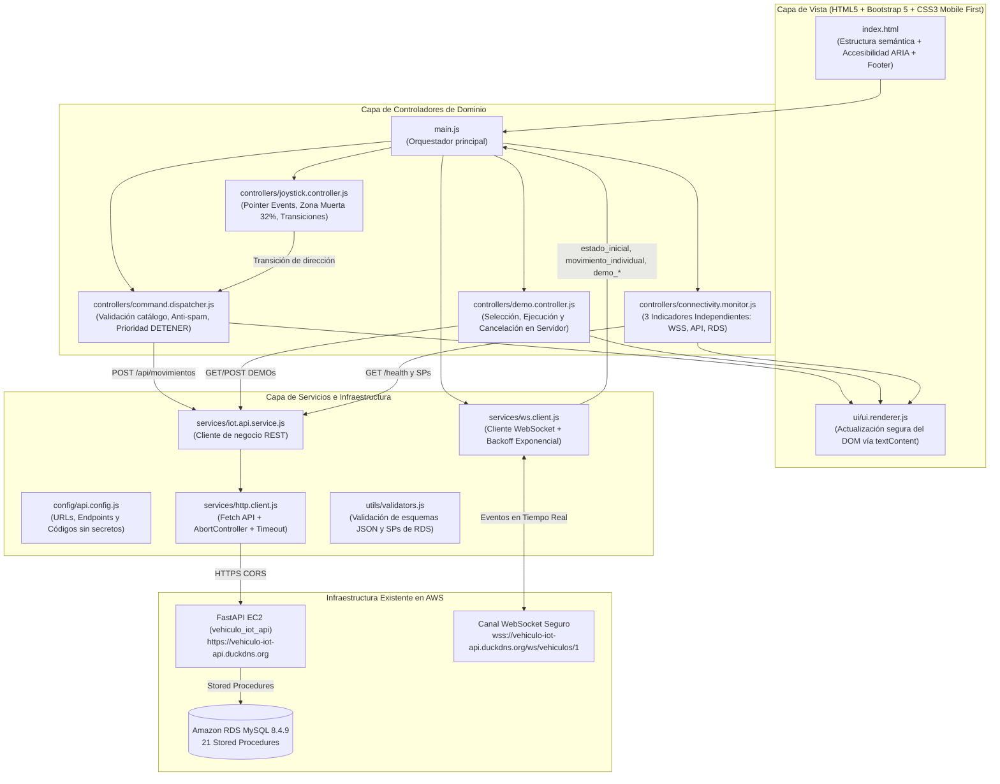

# Mapa de Arquitectura y Flujo de Datos — Práctica 4.1

## 1. Arquitectura Modular del Frontend (ES6 Modules)

La aplicación web de control para la **Excavadora IoT CAT-320 (ID = 1)** sigue una arquitectura desacoplada en capas utilizando módulos nativos de JavaScript ES6, sin frameworks pesados ni credenciales incrustadas.

---

## 2. Flujo de Datos por Operación

### A. Inicialización y Diagnóstico Diferenciado (3 Indicadores)
1. **Servidor AWS (21 APIs):** `ConnectivityMonitor` invoca `GET /health`. Si recibe `{"ok": true, "servicio": "vehiculo_iot_api", "version": "2.6.0"}`, marca **Servidor AWS: Disponible**.
2. **Amazon RDS MySQL:** Como `GET /health` no consulta la base de datos, el indicador RDS permanece en **Sin verificar** hasta que un endpoint basado en Stored Procedure (`GET /api/vehiculos/1`, `GET /api/vehiculos/1/comandos`, `GET /api/vehiculos/1/estado` o `POST /api/movimientos`) confirma una ejecución real en MySQL (`"ok": true, "procedimiento": "sp_..."` o `"transaccion": "confirmada"`). Solo entonces pasa a **Disponible**.
3. **WebSocket WSS:** `VehicleWsClient` abre la sesión hacia `wss://vehiculo-iot-api.duckdns.org/ws/vehiculos/1`. Al abrirse (`open`), muestra **En línea** aclarando que corresponde al enlace navegador ↔ servidor AWS y no implica conexión física del ESP8266.

### B. Flujo del Joystick y Botones Secundarios
1. El usuario desplaza el joystick (`Pointer Events`) o presiona un botón secundario.
2. `JoystickController` calcula el ángulo polar y la magnitud respecto al centro. Si supera el umbral de zona muerta (`32%`) y cambia de cuadrante (`UP=9`, `DOWN=11`, `LEFT=2`, `RIGHT=4`), notifica la transición a `CommandDispatcher`.
3. `CommandDispatcher` verifica que no haya una DEMO activa, comprueba que el código pertenezca al catálogo real cargado desde `GET /api/vehiculos/1/comandos` y envía un único `POST /api/movimientos` con `{"id_vehiculo": 1, "id_comando": <id>, "origen": "WEB_CONTROL_P41"}`.
4. El backend ejecuta la transacción en RDS y difunde el evento `movimiento_individual` por WebSocket a todos los clientes conectados.

### C. Prioridad Absoluta del Botón `DETENER` y Limitación Real del Catálogo
1. El catálogo real devuelto por `GET /api/vehiculos/1/comandos` contiene los códigos `1` al `12` y el esquema OpenAPI exige `id_comando > 0` (`exclusiveMinimum: 0`). **No existe un comando DETENER (ni código 0) en el catálogo actual del backend.**
2. Por ello, la aplicación **no inventa un código 0 ni simula un paro físico inexistente**.
3. Al soltar el joystick o presionar **DETENER**:
   - El joystick retorna inmediatamente a **NEUTRAL**.
   - Se aborta cualquier petición HTTP en tránsito mediante `AbortController`.
   - Si existe una secuencia DEMO en ejecución en el servidor, se invoca inmediatamente `POST /api/vehiculos/1/demo/cancelar` (y `POST /api/demos/{id_demo}/cancelar`) para interrumpir la DEMO en el servidor.
   - Se informa de manera clara y visible al operador en la interfaz.

---

**Desarrollado por Claudia America Hernandez Jimenez · 2026**  
Práctica 4.1 — Aplicación de control para IoT.
